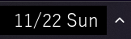
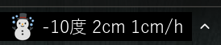

## hekoo

bring your messages/images on the taskbar


### What does 'hekoo' mean?

'hekoo' is a coined term inspired by the 'heko-obi' (兵児帯), a soft sash.  
Picture a band made of software - the image comes from an association
with the lost 'deskband'.

proof of concept with Muse inspired by the amazing invention by @KrisGfx
https://github.com/krisgfx9/Wireless-Device-Battery-Monitor

## Run

```powershell
git clone https://github.com/sharl/hekoo.git
cd hekoo
python -m venv .venv
.\.venv\Scripts\activate
pip install -r requirements.txt
python hekoo.py
```

### Re-run

```powershell
cd hekoo
.\.venv\Scripts\activate
python hekoo.py
```

## Usage

### add text

```bash
$ jo text="hello, hekoo" | curl --json @- 192.168.0.1:19876/segments/hekoo
{"ok": true, "name": "hekoo"}
```


### add text with TTL

TTL default is 900

```bash
$ jo text="$(date +'%m/%d %a')" ttl=86400 | curl -s --json @- 192.168.0.1:19876/segments/calendar
{"ok": true, "name": "calendar"}
```



### add image with text

```bash
$ jo segment=$(jo image="$(base64 -w0 emoji_u2603.png)" text=$(jo -a "\-10度" 2cm 1cm/h) ) | curl -s --json @- 192.168.0.1:19876/segments/weather
{"ok": true, "name": "weather"}
```



### SEE ALSO

Examples use [jo](https://github.com/jpmens/jo) to build JSON from shell arguments.  
Plain JSON works too: curl --json '{"text": "hello, hekoo"}' ...

https://github.com/jpmens/jo

## Build

```powershell
pip install pyinstaller
pyinstaller "hekoo.py" "--onefile" "--noconsole" "--icon=Assets/sample.ico" "--exclude-module=PIL._imagingcms" "--exclude-module=PIL._imagingtk" "--add-data=Assets/version.txt;Assets"
```
